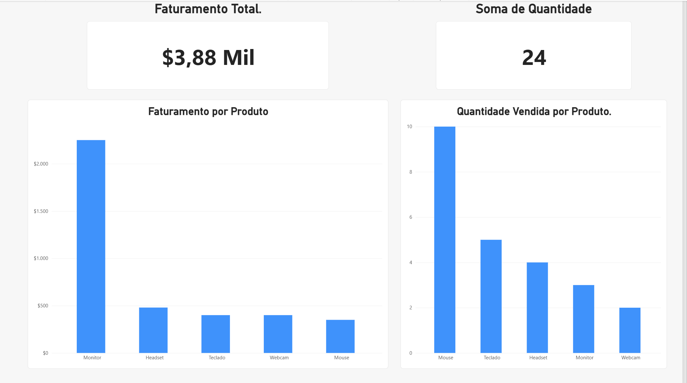

# Projeto de Análise de Vendas — Excel e Power BI

## Sobre o projeto

Este projeto foi desenvolvido para praticar conceitos iniciais de Análise de Dados, utilizando uma base fictícia de vendas de produtos eletrônicos.

O objetivo é analisar o faturamento e a quantidade de produtos vendidos por meio de um dashboard interativo no Power BI.

- 

## Ferramentas utilizadas

- Microsoft Excel
- Power BI Desktop
- GitHub

## Indicadores analisados

- Faturamento total: R$ 3.880,00
- Quantidade total vendida: 24 unidades
- Faturamento por produto
- Quantidade vendida por produto

## O que pratiquei

- Organização de dados no Excel
- Importação de dados para o Power BI
- Criação de gráficos e cartões de indicadores
- Formatação de valores monetários
- Construção de um dashboard
- Publicação de um projeto no GitHub

## Arquivo do projeto

O arquivo `Dashboard_Vendas_Iniciante.pbix` contém o relatório desenvolvido no Power BI.

## Próximos passos

- Adicionar filtros interativos
- Melhorar o layout do dashboard
- Desenvolver novos projetos utilizando SQL e Power BI

---

**Projeto de estudo desenvolvido para fins de aprendizado e construção de portfólio profissional.**
